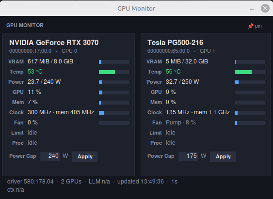

# GPU Monitor

A small desktop window with live stats for every NVIDIA GPU: VRAM, temperature, power, GPU and memory utilization, clocks, fan, throttle reasons and running processes. It also shows tokens per second and context fill for a local LLM, and lets you set a per-card power cap.

## Requirements

- Linux with an NVIDIA driver (`nvidia-smi`)
- Python 3 with Tkinter (both ship with most installs)
- Optional: `pkexec` (polkit) to apply power caps; `sensors` (lm-sensors) for the fan row on passively cooled cards

No Python packages to install.

## Run

    python3 gpu_monitor.py                 # open the monitor
    python3 gpu_monitor.py --interval 2    # refresh every 2 s
    python3 gpu_monitor.py --topmost       # start always-on-top
    python3 gpu_monitor.py --once          # print one JSON snapshot and exit

## Settings

Defaults (power caps, fan max RPM, refresh rate, color thresholds) live in `settings.json` next to the script. It is created on first run and you can edit it. It is not stored in this repo because it holds per-machine values.

## Power caps

Type a wattage in a card's Power Cap box and press Apply. Linux asks for authorization through polkit, then runs `nvidia-smi -pl` for that one GPU after checking the value is within the card's allowed range.

## LLM readout

The "LLM" and "ctx" lines read tokens per second and context fill from a local llama.cpp-style server found on loopback ports, or from a LiteLLM proxy's `/metrics` endpoint if you enable it. For the LiteLLM route the script reads `master_key` from `~/litellm/config.yaml` on your own machine at runtime. It does not print or store the key. If those sources aren't present, the line shows "n/a".
